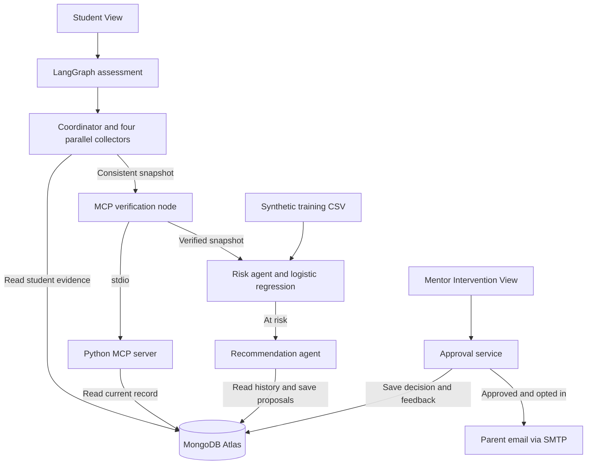

# Student Success & Early Warning System

Team D11’s Agentic AI course project helps a student and mentor act on early signs of academic difficulty. A student signs in to see a risk assessment and the evidence behind it. If support is needed, the system proposes an intervention, records the mentor’s decision, and uses that feedback the next time the student is assessed.

Browse the [complete application](Complete_Project/), [implementations for Labs 01–14](labwise_implementations/), [project report (PDF)](Complete_Project/D-11_report.pdf), or [worklet (Word)](Complete_Project/D-11%20Student%20Success%20Worklet%20-%20final.docx).

## How an assessment works

1. **Sign in.** Streamlit routes students to their own Student View. Mentors see the intervention review queue and the lab workspace. Accounts link to existing student or mentor profiles in MongoDB.
2. **Collect evidence.** A coordinator sends the student ID to four Python agents in parallel. The Contineo agent reads the student profile, the LMS agent reads academic results and attendance, and the internship and placement agents read career status. These are logical roles backed by the project’s MongoDB repositories. The coordinator checks that all four results agree with the profile.
3. **Verify and score.** A LangGraph node retrieves the record again through the Model Context Protocol (MCP) server and compares the student ID and four academic fields. Missing or conflicting evidence stops the assessment. After verification, a scikit-learn logistic regression model uses attendance, marks, assignment performance, and backlog count to produce a risk label and probability. The model trains on the supplied synthetic student data. Separate threshold rules generate the reasons displayed to the student.
4. **Propose support.** For an at-risk student, the recommendation agent combines academic indicators, career status, and intervention history. New proposals are stored as pending. For example, low attendance can prompt an attendance plan. A previously rejected plan with timetable feedback can lead to an asynchronous mentor check-in.
5. **Review and follow up.** A mentor approves or rejects a pending proposal and can record feedback. Approval triggers a parent notification when the linked contact has email enabled. Delivery status is recorded separately, so the mentor’s decision remains available even if SMTP delivery fails.

## Architecture



| Component | Responsibility and source |
| --- | --- |
| Interface and identity | Streamlit navigation, sign-in, student registration, role checks, and session state. [Application entry point](Complete_Project/app/main.py) · [Authentication](Complete_Project/app/auth/) · [Views](Complete_Project/app/ui/) |
| Workflow and recovery | LangGraph orders collection, verification, and scoring. The parallel runner retries eligible transient collector failures. The graph retries scoring once and supports resuming a failed assessment. Student View keeps paused state in the session. The recovery CLI can persist a checkpoint to disk. [Node graph](Complete_Project/app/workflows/node_graph.py) · [Parallel runner](Complete_Project/app/workflows/parallel_swarm.py) |
| Agents, skills, and tools | The runtime dispatches named Python callables through registries and audits executions. Collectors use data-access tools. The risk and recommendation agents implement scoring and intervention planning. [Runtime](Complete_Project/app/runtime/) · [Agents](Complete_Project/app/agents/) · [Tools](Complete_Project/app/tools/) · [Model](Complete_Project/app/ml/risk_model.py) |
| Data access and MCP | PyMongo repositories validate and persist application records. The MCP client launches a Python server over standard input/output. The server exposes an Atlas lookup, CSV resource, SQLite lookup, and mock API for the labs. [Repositories](Complete_Project/app/database/repositories.py) · [MCP client and server](Complete_Project/app/mcp/) |
| Memory and notifications | MongoDB stores application accounts, profiles, interventions, mentor feedback, and notification records. The runtime also has a local JSON memory store and audit log. The approval service checks the decision and parent preferences before calling SMTP. [Memory](Complete_Project/app/memory/) · [Approval service](Complete_Project/app/safety/approval.py) · [Email delivery](Complete_Project/app/notifications/email_service.py) |
| Mentor labs | Research briefing compares claims from local sources and flags gaps. Cloud incident simulates version rollback and measures recovery. Release review stages an attendance rule, runs boundary checks, and records approval or rollback in a separate SQLite database. An OpenClaw workspace skill exposes the research CLI. [Mentor workspace](Complete_Project/app/ui/labs.py) · [Release workflow](Complete_Project/app/workflows/release_lab.py) · [Workspace skill](Complete_Project/skills/student-research/SKILL.md) |

## Run the application

Use Python 3.12. From the repository root in PowerShell, create an environment inside the complete project. Run subsequent commands from that directory so the model and runtime can find their data files.

```powershell
cd Complete_Project
py -3.12 -m venv .venv
.\.venv\Scripts\Activate.ps1
python -m pip install -r requirements.txt
Copy-Item .env.example .env
$env:PYTHONPATH = (Get-Location).Path
```

Set `MONGODB_URI` and `MONGODB_DATABASE` in the new `.env` to an accessible demo database. To demonstrate email delivery, set the SMTP values and use a parent address you control. The variable names and defaults are in the [configuration example](Complete_Project/.env.example).

**For a fresh demo database**, run the following once. The seed command creates local SQLite tables and loads the sample students. The migration checks the five CSVs for consistency, creates Atlas indexes, and writes student profiles, parent records, and any existing SQLite interventions to the configured database.

```powershell
python -m app.database.seed
python -m app.database.migration
```

Start the dashboard and open the local URL printed by Streamlit.

```powershell
python -m streamlit run app/main.py
```

Use **Student Sign Up** with an imported student ID such as `STU003`. To demonstrate mentor review, sign in with a provisioned mentor account in a second browser session. On a fresh database, create a mentor profile with `create_mentor` (ID, name, email, and department), then link a login with `register_user` using the same ID and the `mentor` role. [Profile repository](Complete_Project/app/database/repositories.py) · [Account registration](Complete_Project/app/auth/authentication.py)

## Explore and test

Run these commands from `Complete_Project` with the environment active.

| Command | What it demonstrates |
| --- | --- |
| `python -m app.ml.risk_model` | Train on the bundled CSV and print holdout metrics, a confusion matrix, and feature coefficients. |
| `python -m app.research.research_agent` | Produce a research briefing from local project evidence. |
| `python -m app.workflows.node_graph --demo-recovery STU003` | Use the configured database to demonstrate a scoring failure, retry, and checkpoint recovery. |
| `python -m pip install pytest` followed by `python -m pytest -q tests/test_parallel_swarm.py` | Exercise the collectors with test fixtures, including timeouts and conflicting evidence. |

The [demonstration guide](Complete_Project/docs/demo.md) walks through all fourteen labs. The [test suite](Complete_Project/tests/) also covers the node graph, mentor approvals, notifications, release governance, research, and incident simulation.
